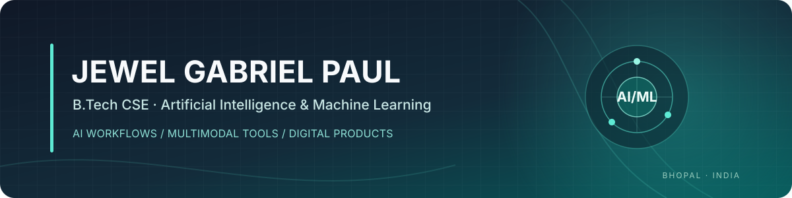

  

  <a href="https://github.com/JewelPaul">GitHub</a>
  &nbsp;·&nbsp;
  <a href="mailto:jewelpaul2513@gmail.com">Email</a>
  &nbsp;·&nbsp;
  Bhopal, Madhya Pradesh, India

---

## About

I am a second-year **B.Tech Computer Science and Engineering (Artificial Intelligence and Machine Learning)** student at **Lakshmi Narain College of Technology and Science (LNCTS)**, Bhopal.

My work centers on applied artificial intelligence, multimodal AI workflows, and digital product development. Rather than treating AI as a single-model prompt box, I focus on how multiple complementary models and tools can be orchestrated together—selecting different systems for research, structured reasoning, comparative analysis, multimodal exploration, prototyping, and iterative product refinement.

I am driven by taking software ideas beyond abstract concepts and engineering practical, clean digital experiences while continuously building strong engineering fundamentals.

---

## AI Workflows & Multi-Model Systems

A core strength of my workflow is combining distinct AI platforms to overcome individual model blind spots and achieve higher-fidelity outcomes:

* **Primary Platforms:** ChatGPT, Google Gemini, Muse, Google Antigravity, and Ollama (local model inference).
* **Multi-Model Orchestration & Comparative Reasoning:** Querying parallel model architectures on complex problems to cross-evaluate proposed solutions, contrast differing approaches, and synthesize robust implementations.
* **Context Engineering & System Design:** Designing structured context prompts, persona constraints, and iterative feedback loops that produce reproducible technical plans and clean code.
* **Multimodal Exploration:** Utilizing cross-modal inputs (vision, structured datasets, and natural language) to explore interface layouts, workflows, and visual architectures.
* **AI-Assisted Prototyping & Iteration:** Accelerating the feedback cycle from conceptual architecture to functional web prototypes through continuous, disciplined refinement.

---

## Selected Projects

### [BravoMail](https://github.com/JewelPaul/BRAVOMAIL)
**Active Web Project · Disposable Email Platform**

An independently developed, browser-based temporary email platform created to give users instant disposable email addresses and a privacy-focused inbox experience without registration.

* **Frontend Architecture:** Built with TypeScript, React 18, and Vite, featuring a component system powered by Tailwind CSS and Radix UI primitives.
* **API Integration & Resilience:** Integrated with the `api.mail.tm` REST API with an automated CORS proxy fallback detection mechanism and exponential retry handling to maintain service reliability.
* **Heuristic OTP Detection:** Designed a client-side regex engine (`otpDetection.ts`) that automatically analyzes incoming email text to extract, highlight, and enable one-click copying of numeric and alphanumeric authentication codes.
* **State & Synchronization:** Utilizes TanStack React Query for efficient data fetching, caching, and periodic polling of inbox states.

---

### AI-Integrated Financial Management
**Upcoming Project · Personal Finance & Applied AI**

A planned personal finance web application exploring how ambient AI assistance can simplify everyday financial tracking, budgeting, and account comprehension.

* **Core Focus:** Clean transaction recording, automatic category classification, and structured financial summaries.
* **AI Assistance:** Context-aware insights that explain spending patterns and provide intelligent query-based financial analysis without exposing sensitive credentials.
* **Status:** In concept development and architectural planning.

---

### Interactive E-commerce Experience
**Upcoming Project · Digital Product Experience**

An upcoming web application focused on building a holistic, interactive shopping journey that moves beyond basic product catalog listings.

* **Core Focus:** Dynamic product discovery flows, interactive cart operations, streamlined checkout state simulation, and order lifecycle tracking.
* **Design Objectives:** Polished interaction design, responsive desktop and mobile viewports, and clean UI state machines.
* **Status:** In design and interface prototyping.

---

## Focus Areas & Technical Toolkit

### Areas of Focus
Applied Artificial Intelligence · Multimodal AI Systems · Machine Learning & Deep Learning Foundations · AI-Assisted Product Workflows · Digital Product Development · Web Application Architecture

### Languages & Web Technologies
* **Languages:** TypeScript, JavaScript, HTML5, CSS3, Python
* **Frontend Frameworks & Libraries:** React 18, Vite, Tailwind CSS, Radix UI primitives, TanStack React Query
* **Tooling & Environment:** Git, GitHub, Node.js, VS Code, PowerShell

### AI Platforms in Workflow
ChatGPT · Google Gemini · Ollama · Google Antigravity · Muse

---

## Education

**Lakshmi Narain College of Technology and Science (LNCTS)**  
*Bachelor of Technology (B.Tech) — Computer Science & Engineering (Artificial Intelligence & Machine Learning)*  
Currently pursuing **Second Year** · Bhopal, India

| Qualification | Board / University | Result |
| :--- | :--- | :--- |
| **B.Tech (CSE — AI & ML)** | LNCTS (RGPV) | *In Progress (2nd Year)* |
| **Class XII (Senior Secondary)** | CBSE | **82%** |
| **Class X (Secondary)** | CBSE | **95%** |

---

## Certifications & Internship

### Certifications & Professional Development
* **Generative AI Mastermind** — Outskill
* **Accelerating Deep Learning with GPUs** — IBM, Cognitive Class
* **AI in Digital Marketing** — The Digital School
* **Guiding Students Towards Modern Technology & Industry-Relevant Careers** — SkillSpardha Workshop

### Internship Experience
* **Graphic Designing Intern** — Codec Technologies Pvt. Ltd.  
  *Completed a one-month internship programme focusing on visual communication, digital design assets, and layout principles.*

---

## Contact

Feel free to connect or reach out regarding projects, technology collaborations, or engineering ideas:

* **GitHub:** [github.com/JewelPaul](https://github.com/JewelPaul)
* **Email:** [jewelpaul2513@gmail.com](mailto:jewelpaul2513@gmail.com)
* **Location:** Bhopal, Madhya Pradesh, India

 

  Curated technology portfolio · Jewel Gabriel Paul · Bhopal, India

